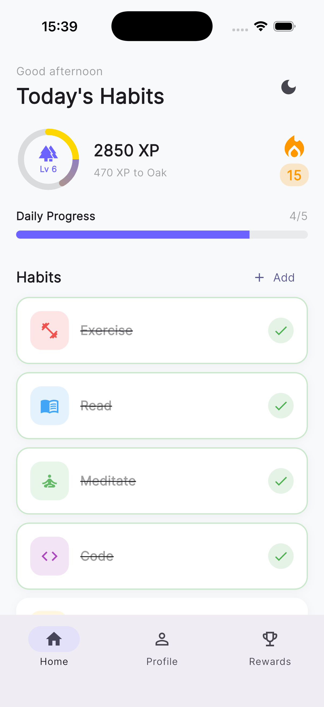
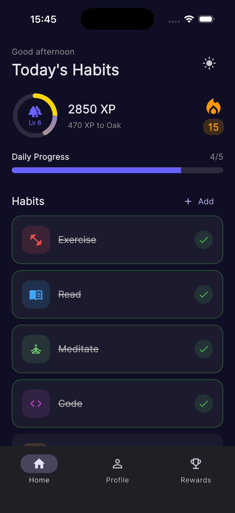
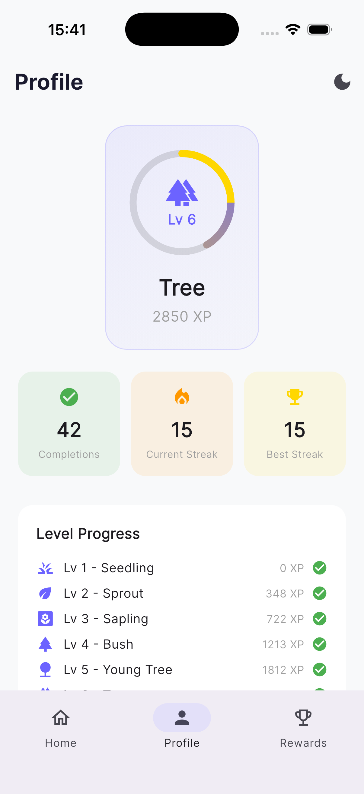
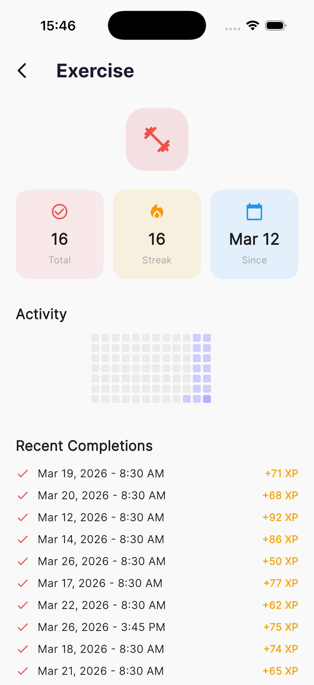
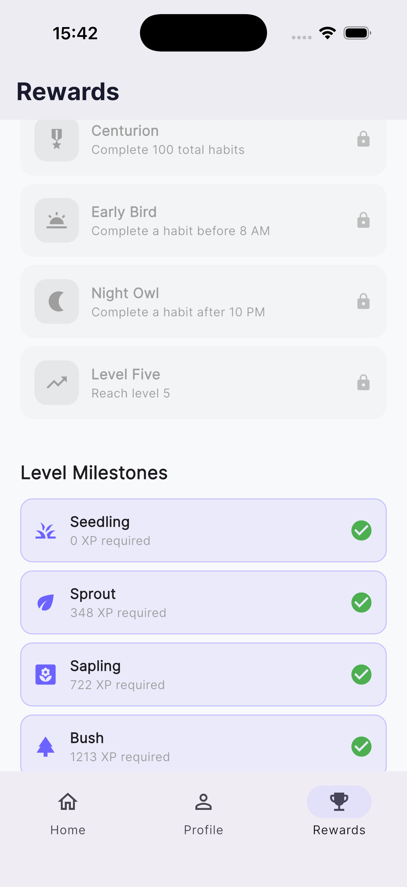

# Flutter Gamified Habits

A polished daily habit tracker with full gamification mechanics - XP, levels, streaks, badges, confetti particles, and haptic feedback. Built with Flutter to demonstrate production-grade animations, custom painters, gesture interactions, and clean architecture.

## Screenshots

| Home (Light) | Home (Dark) | Profile | Detail | Rewards |
|:---:|:---:|:---:|:---:|:---:|
|  |  |  |  |  |

## What This Demonstrates

- **Custom `CustomPainter`** for XP progress ring, calendar heatmap, and confetti particle system (no heavy animation packages)
- **Swipe-to-complete** gesture with haptic feedback and particle confetti burst
- **Gamification engine**: XP with streak multiplier + combo bonus, 10 level progression, 12 achievement badges
- **`flutter_animate`** declarative animation chains for staggered list entrances and micro-interactions
- **Riverpod** state management with `StateNotifier` pattern and provider composition
- **Hive** local persistence with JSON serialization (Freezed models stored as JSON strings)
- **GoRouter** declarative routing with custom page transitions (fade+slide, slide-up)
- **Hero transitions** between habit cards and detail screens
- **Dark mode** toggle with full theme support
- **Drag-to-reorder** habit list via `ReorderableListView`
- **Clean Architecture**: Presentation -> Domain -> Data layer separation

## Architecture

```
┌─────────────────────────────────────────────────────┐
│                   Presentation                       │
│  ┌──────────┐  ┌──────────┐  ┌───────────────────┐  │
│  │  Screens  │  │ Providers │  │  Shared Widgets   │  │
│  │  (Home,   │  │ (Riverpod │  │  (XpRing, Flame,  │  │
│  │  Detail,  │  │  State    │  │   Confetti, Toast, │  │
│  │  Profile, │  │  Notifier)│  │   Calendar, Bounce)│  │
│  │  Rewards) │  │           │  │                    │  │
│  └─────┬─────┘  └─────┬─────┘  └────────────────────┘  │
│        │              │                                  │
├────────┼──────────────┼──────────────────────────────────┤
│        ▼              ▼         Domain                   │
│  ┌──────────────┐  ┌───────────────────────────────┐     │
│  │   UseCases    │  │          Services              │     │
│  │ (Complete     │  │  (XP, Streak, Level, Badge)    │     │
│  │  Habit)       │  │                                │     │
│  └──────┬────────┘  └───────────────────────────────┘     │
│         │                                                  │
├─────────┼──────────────────────────────────────────────────┤
│         ▼              Data                                │
│  ┌──────────────┐  ┌────────────────────────┐              │
│  │ Repositories  │  │   Models (Freezed)     │              │
│  │ (Habit,       │  │  (Habit, Completion,   │              │
│  │  Profile)     │  │   UserProfile)         │              │
│  └──────┬────────┘  └────────────────────────┘              │
│         │                                                    │
│         ▼                                                    │
│  ┌──────────────┐                                            │
│  │  Hive (JSON)  │                                            │
│  └───────────────┘                                            │
└──────────────────────────────────────────────────────────────┘
```

## Project Structure

```
lib/
├── main.dart                          # App entry, Hive init, seed data
├── core/
│   ├── constants/
│   │   ├── gamification.dart          # XP formulas, level thresholds
│   │   ├── badge_definitions.dart     # 12 badge definitions
│   │   └── default_habits.dart        # 5 starter habits
│   ├── theme/
│   │   └── app_theme.dart             # Light/dark themes, color palette
│   └── services/
│       └── haptic_service.dart        # Cross-platform haptic feedback
├── data/
│   ├── models/
│   │   ├── habit.dart                 # Freezed + JSON serializable
│   │   ├── completion.dart
│   │   └── user_profile.dart
│   └── repositories/
│       ├── habit_repository.dart      # Hive CRUD for habits + completions
│       └── profile_repository.dart    # Hive CRUD for user profile
├── domain/
│   ├── services/
│   │   ├── xp_service.dart            # Base XP + streak multiplier + combo
│   │   ├── streak_service.dart        # Daily streak logic + freeze
│   │   ├── level_service.dart         # Level from XP + progress calc
│   │   └── badge_service.dart         # 12 badge condition checks
│   └── usecases/
│       └── complete_habit.dart        # Orchestrates full completion flow
└── presentation/
    ├── providers/
    │   └── providers.dart             # All Riverpod providers
    ├── router/
    │   ├── app_router.dart            # GoRouter with custom transitions
    │   └── shell_scaffold.dart        # Bottom navigation shell
    ├── screens/
    │   ├── home/
    │   │   ├── home_screen.dart       # Main screen: habits, XP ring, streak
    │   │   ├── habit_card.dart        # Swipe-to-complete card
    │   │   └── add_habit_sheet.dart   # Bottom sheet with icon/color picker
    │   ├── detail/
    │   │   └── detail_screen.dart     # Habit detail with calendar heatmap
    │   ├── profile/
    │   │   └── profile_screen.dart    # Level badge, counters, badge grid
    │   └── rewards/
    │       └── rewards_screen.dart    # Badge list, level milestones
    └── shared/
        ├── xp_progress_ring.dart      # CustomPainter animated XP ring
        ├── streak_flame.dart          # Pulsing flame with streak count
        ├── particle_effect.dart       # Confetti + level-up explosion
        ├── bounce_tap.dart            # Scale bounce + haptic wrapper
        ├── xp_toast.dart              # +XP float-up notification
        └── completion_calendar.dart   # GitHub-style heatmap painter
```

## Gamification Mechanics

### XP Calculation

```
Total XP = (Base XP x Streak Multiplier) + Combo Bonus

Base XP:           50 per completion
Streak Multiplier: 1.0 + (streak_days x 0.1), capped at 2.0x
Combo Bonus:       +10 XP per extra habit completed that day
```

| Streak Days | Multiplier | Base XP Result |
|-------------|-----------|----------------|
| 0           | 1.0x      | 50 XP          |
| 5           | 1.5x      | 75 XP          |
| 10+         | 2.0x      | 100 XP         |

### Level Progression

Threshold formula: `100 x n^1.8`

| Level | Name       | XP Required |
|-------|-----------|-------------|
| 1     | Seedling   | 0           |
| 2     | Sprout     | 348         |
| 3     | Sapling    | 835         |
| 4     | Bush       | 1,468       |
| 5     | Young Tree | 2,246       |
| 6     | Tree       | 3,167       |
| 7     | Oak        | 4,228       |
| 8     | Ancient Oak| 5,427       |
| 9     | Elder Tree | 6,761       |
| 10    | World Tree | 8,228       |

### Badges (12 total)

| Badge          | Condition                        |
|---------------|----------------------------------|
| First Step     | Complete your first habit        |
| Hat Trick      | 3 habits in one day              |
| Perfect Day    | All habits in one day            |
| On Fire        | 7-day streak                     |
| Week Warrior   | All habits daily for a week      |
| Fortnight      | 14-day streak                    |
| Monthly Master | 30-day streak                    |
| Centurion      | 100 total completions            |
| Early Bird     | Complete before 8 AM             |
| Night Owl      | Complete after 10 PM             |
| Diversified    | 5+ active habits                 |
| Level Five     | Reach level 5                    |

### Streaks

- Increments on consecutive days with at least one completion
- Resets to 1 on a missed day
- One free freeze per week (preserves streak)
- Flame animation grows at milestones: 3, 7, 14, 30 days

## Key Animations

| Animation | Implementation |
|-----------|---------------|
| XP Progress Ring | `CustomPainter` + `AnimationController` with gradient sweep |
| Confetti Burst | Custom particle system (25 particles, gravity, fade) via `CustomPainter` |
| Level-Up Explosion | Full-screen 50-particle burst with scale sequence |
| Streak Flame | Pulsing `ScaleTransition` that repeats |
| Habit Cards | Staggered `fadeIn` + `slideX` via `flutter_animate` |
| Badge Grid | Staggered `fadeIn` + `scale` entrance |
| XP Toast | Float-up `Transform.translate` + fade-out |
| Bounce Tap | `ScaleTransition` with elastic curve + haptic |
| Calendar Heatmap | `CustomPainter` rendering 84 day-cells with intensity colors |
| Stats Count-Up | `TweenAnimationBuilder<int>` for animated counters |
| Daily Progress | `TweenAnimationBuilder<double>` on `LinearProgressIndicator` |

## Prerequisites

- Flutter SDK 3.41+ (Dart 3.11+)
- Xcode 16+ (for iOS)
- Android Studio / Android SDK (for Android)

## Build & Run

```bash
# Install dependencies
flutter pub get

# Generate Freezed models
dart run build_runner build --delete-conflicting-outputs

# Run on iOS Simulator
flutter run -d ios

# Run on Android Emulator
flutter run -d android

# Run tests
flutter test

# Analyze
flutter analyze
```

## Testing

33 unit tests covering all gamification services:

```
test/
├── widget_test.dart
└── services/
    ├── xp_service_test.dart        # 7 tests: base XP, multiplier, combo
    ├── streak_service_test.dart    # 9 tests: increment, reset, milestone
    ├── level_service_test.dart     # 8 tests: thresholds, level-up, progress
    └── badge_service_test.dart     # 9 tests: all badge conditions
```

## Tech Stack

| Package | Purpose |
|---------|---------|
| `flutter_riverpod` | State management (StateNotifier pattern) |
| `go_router` | Declarative routing + custom page transitions |
| `hive_flutter` | Local persistence (JSON in Hive boxes) |
| `freezed` + `json_serializable` | Immutable data models with serialization |
| `flutter_animate` | Declarative animation chains |
| `google_fonts` | Typography (Inter) |
| `uuid` | Unique habit/completion IDs |
| `intl` | Date formatting |

## Future Enhancements

- Notifications / daily reminders
- Habit categories and filtering
- Weekly/monthly stats charts
- Social sharing of achievements
- Habit templates marketplace
- Cloud sync via Firebase
- Widget for home screen
